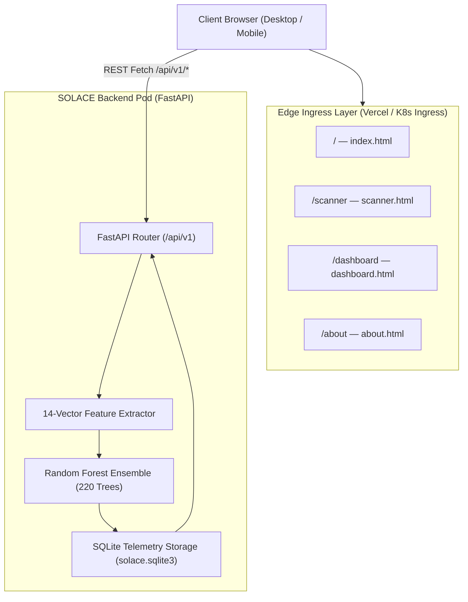

# 📚 SOLACE — Confluence System Architecture Specification

> **Document Space:** `SOL-ARCH`  
> **Document Title:** SOLACE End-to-End System Design & Architecture Specification  
> **Classification:** Capstone Engineering Blueprint  

---

## 1. Executive Summary

**SOLACE** is a high-performance URL threat intelligence platform designed to detect zero-hour credential phishing, domain typosquatting, and deceptive link structures. Unlike traditional web security tools that issue HTTP connections (exposing clients to drive-by exploits), SOLACE operates strictly as a **Zero-Execution Lexical Sandbox**.

---

## 2. Architecture Decision Records (ADRs)

### ADR-001: Zero-Execution Client Architecture
* **Status:** Accepted
* **Context:** Visiting suspect domains to inspect HTML contents triggers attacker honeytokens, executes obfuscated client-side malware, and tips off attackers.
* **Decision:** Extract exclusively lexical, structural, and mathematical features from the URL string itself. Never issue network requests to the target domain.
* **Consequences:** Near-instant classification latency (<50ms) and zero risk of malware infection.

### ADR-002: Random Forest Ensemble over Deep Neural Networks
* **Status:** Accepted
* **Context:** Deep neural networks (LSTMs, Transformers) introduce high inference latency, large artifact sizes, and opacity (black-box decisions).
* **Decision:** Deploy a 220-tree scikit-learn `RandomForestClassifier` bounded at `max_depth=14`.
* **Consequences:** Transparent Gini feature-importance explainability (XAI), predictable memory footprints (~380KB artifact), and CPU execution under 10ms.

### ADR-003: 4-Page Vanilla Frontend with Edge CDN Deployment
* **Status:** Accepted
* **Context:** Heavy single-page-application frameworks (React, Next.js) introduce complex build pipelines, dependency rot, and large bundle sizes.
* **Decision:** Use semantic HTML5, modern CSS3 custom properties, vanilla ES6 modules, and Chart.js via CDN.
* **Consequences:** Zero-build static deployment to Vercel/Netlify with 100/100 Lighthouse performance and instant time-to-interactive.

---

## 3. High-Level System Architecture Diagram



---

## 4. 14-Dimensional Mathematical Feature Vector

| Feature Name | Type | Mathematical / Computational Formulation | Security Justification |
|---|---|---|---|
| `url_length` | Integer | Total character count `len(URL)` | Long URLs frequently embed base64 redirects or deep path structures. |
| `hostname_length` | Integer | Hostname string length | Identifies synthetic generated domains. |
| `dot_count` | Integer | Count of `.` characters in host | Deep domain segmentation hides authentic registrars. |
| `hyphen_count` | Integer | Count of `-` characters in URL | Frequently used to mimic genuine brands (e.g., `paypal-verify`). |
| `at_symbol` | Binary (0/1) | Evaluates `@ in URL` | Basic HTTP auth obfuscation obscures genuine destination host. |
| `ip_address` | Binary (0/1) | `ipaddress.ip_address(host)` | Direct IP addressing bypasses domain reputational audits. |
| `https_scheme` | Binary (0/1) | Evaluates `scheme == 'https'` | Baseline protocol posture. |
| `suspicious_keyword_count`| Integer | Matches against `SUSPICIOUS_WORDS` token set | Quantifies presence of urgency, credentials, or prize lures. |
| `digit_ratio` | Float | `count(digits) / len(URL)` | High numeric ratio corresponds with disposable host generation. |
| `subdomain_depth` | Integer | `max(0, len(labels) - 2)` | Identifies sub-nesting abuse on public cloud services. |
| `path_length` | Integer | Length of path string | Complex nested directories indicate phishing kits. |
| `query_length` | Integer | Length of query string | Parameter hijacking and tracking tokens. |
| `entropy` | Float | Shannon entropy $-\sum p(x) \log_2 p(x)$ | Statistical measure of character unpredictability in hostname. |
| `shortener_host` | Binary (0/1) | Lookup in `SHORTENERS` set | Bitly, TinyURL, and shorteners conceal destination risk. |

---

## 5. REST API Specifications

### `POST /api/v1/scans`
- **Request:** `{ "url": "string" }`
- **Response (200 OK):**
  ```json
  {
    "id": 142,
    "rawUrl": "http://paypal-verification.security-notice-24.top/signin",
    "protocol": "http",
    "subdomain": "paypal-verification",
    "rootDomain": "security-notice-24.top",
    "tld": "top",
    "pathAndQuery": "/signin",
    "finalRiskScore": 94,
    "verdict": "PHISHING",
    "confidence": "96.4% model confidence",
    "latencyMs": 14,
    "triggers": [
      "The trained Random Forest classifier assigned a high phishing probability.",
      "Contains 2 credential, urgency, or reward-related keyword(s).",
      "The .top top-level domain is frequently abused in suspicious URLs."
    ],
    "featuresList": [ ... ]
  }
  ```

### `GET /api/v1/analytics/summary`
- **Response (200 OK):**
  ```json
  {
    "total_scans": 182,
    "phishing": 44,
    "suspicious": 28,
    "safe": 110
  }
  ```

### `GET /api/v1/model`
- **Response (200 OK):**
  ```json
  {
    "name": "Random Forest (scikit-learn)",
    "training_rows": 6000,
    "metrics": {
      "accuracy": 0.981,
      "precision": 0.983,
      "recall": 0.979,
      "f1": 0.981
    },
    "feature_importance": [
      { "name": "Entropy", "importance": 0.245 },
      { "name": "Suspicious Keyword Count", "importance": 0.198 }
    ]
  }
  ```
