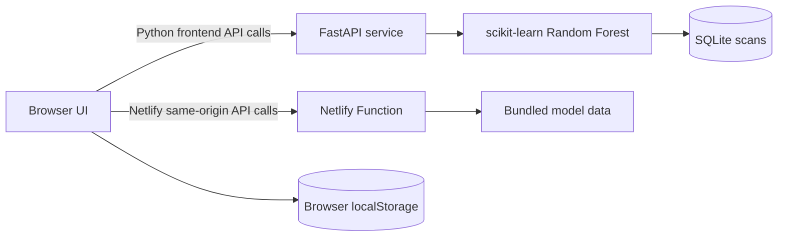

# SOLACE architecture and implementation notes

This document describes the code currently in this repository. The repository has a Python implementation and a separate Netlify implementation; they share a user experience and analysis approach, but are not the same deployment artifact.

## Overview

The scanner accepts a URL string, normalizes and parses it locally, extracts 14 structural features, scores the feature vector with a Random Forest model, and returns a verdict with explanatory signals. It does not request the submitted URL or its hostname.

## Implementations

### Python service and static frontend

- `frontend/` contains four static pages and a JavaScript API client.
- `backend/main.py` provides the FastAPI routes, URL normalization, feature extraction, model inference, SQLite persistence, analytics, and CSV retraining endpoint.
- The UI defaults to the API at `http://127.0.0.1:8001`; deployments need an appropriate configured API base and CORS policy.
- SQLite stores scan URLs, verdicts, risk scores, model signals, features, and timestamps. `PHISHGUARD_DB_PATH` can override its file path.

### Netlify implementation

- `appdeploy-solace/` contains the Netlify build, static pages, model data, and serverless API function.
- The Netlify Function executes the bundled model in the function runtime and serves same-origin API routes.
- Scan history is stored by the browser in `localStorage`; the serverless function's `GET /api/v1/scans` returns an empty list. This version does not share history between browsers.
- This implementation has no Python backend, SQLite store, or model retraining endpoint.

See [API reference](API.md) and [deployment guide](DEPLOYMENT.md) for the route and hosting details.

## URL parsing and feature extraction

Both implementations trim the input, reject empty or overlong values, reject whitespace/control characters, add `https://` when a scheme is missing, and accept only HTTP or HTTPS URLs. They then derive structural features without connecting to the URL.

The 14 feature names are `url_length`, `hostname_length`, `dot_count`, `hyphen_count`, `at_symbol`, `ip_address`, `https_scheme`, `suspicious_keyword_count`, `digit_ratio`, `subdomain_depth`, `path_length`, `query_length`, `entropy`, and `shortener_host`.

The implementation uses simple hostname label splitting for subdomain and root-domain display. It does not use a public suffix database. Detailed definitions and interpretation cautions are in [Scoring and limitations](SCORING_AND_LIMITATIONS.md).

## Scoring

The Python API scores the positive (phishing) class probability of a 220-tree scikit-learn Random Forest. On first run without a saved model artifact, it creates a reproducible synthetic starter dataset and trains a model. Verdict thresholds are `SAFE` for scores below 45, `SUSPICIOUS` for 45–74, and `PHISHING` for 75 or higher.

The Netlify implementation has an included model artifact encoded as TypeScript data and runs equivalent model inference in the function. Neither implementation provides real-time external reputation checks. Synthetic-data metrics are not measures of real-world detection performance.

## Design decisions

### ADR-001: Analyze the URL without visiting its destination

**Decision:** Extract URL structure and compute a model score without issuing requests to the submitted host.

**Reason:** The scanner should not execute a suspicious page or disclose the analyst's IP address by visiting it.

**Trade-off:** Without page contents, redirect chains, DNS, registration data, or live reputation feeds, results are limited to the visible URL string and model patterns.

### ADR-002: Keep results explainable

**Decision:** Return the input feature values, model probability, and human-readable structural signals.

**Reason:** Analysts should be able to see which URL patterns contributed context around a verdict.

**Trade-off:** Model probabilities and feature importance are not calibrated evidence of safety. They can be wrong, especially on data unlike the synthetic training examples.

### ADR-003: Keep the UI static and the API deployable separately

**Decision:** Use static HTML/CSS/JavaScript for the four-page UI; provide both a Python API and a Netlify Function implementation.

**Reason:** Static pages are simple to host, while the two backend options support local learning and a serverless demo.

**Trade-off:** The two API implementations have different persistence and endpoint capabilities. Documentation and deployment configuration must identify which implementation is in use.

## Storage and operational considerations

- The Python implementation stores scan data in SQLite and includes unauthenticated delete and retrain routes. Do not expose it publicly without access controls.
- Submitted URLs can contain credentials or tokens in their query strings. Treat scan history as sensitive and avoid real secrets in demos.
- The Netlify implementation stores recent scan results in the browser, not in a shared server database.
- The included Kubernetes and Vercel files are deployment starting points and need review for API routing, CORS, TLS, persistence, and access control.

## Related references

- [API reference](API.md)
- [Deployment guide](DEPLOYMENT.md)
- [Scoring and limitations](SCORING_AND_LIMITATIONS.md)
- [Jira backlog](JIRA_SPRINT_BACKLOG.md)
